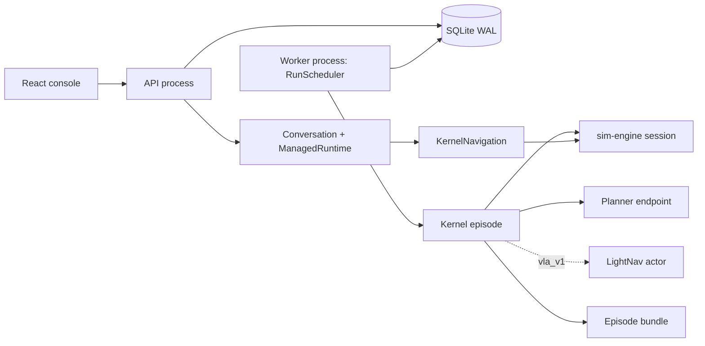

# Architecture

Open Nav Harness is the Planner side of a navigation stack. A kernel agent loop drives a stateful
sim-engine session, so the harness holds no simulator. Source of truth is the code; this page names
the boundaries.

## Ownership

| Layer | Owns | Must not own |
|---|---|---|
| sim-engine (separate project) | Habitat state, observations, grounding, path planning and tracking, rewards and metrics | Prompts, model calls, tool schemas |
| `open_nav_harness/kernel` | Agent loop, tool sets, executors, evidence, episode bundle, preflight | Simulator state, goals, geometry |
| `open_nav_harness/providers` | Chat Completions and Responses clients, token counting, the dialogue loop (`ManagedRuntime`) | Environment state, navigation tools |
| `open_nav_harness/core` | Config contracts, content-addressed artifacts, context budget, kernel digest | Model loading |
| `open_nav_harness/platform` | API, runs, scheduler, conversations, service lifecycle, catalog, database | Navigation semantics |
| `open_nav_harness/actors` | The LightNav actor service (own CUDA environment) | Orchestration |
| `frontend` | Presentation of `/harness` and `/workbench` | Run, queue or tool rules |

## Kernel

One agent loop (`kernel/loop.py`) runs a model against a tool set. A tool set is the permission
boundary: only listed tools exist, and each is written for one executor kind (`spec.py`).

| Tool set | Executor | `delegate` carries |
|---|---|---|
| `point_v1` | `PointExpert`: sim-engine grounds the pixel, plans a path and tracks it | view, pixel point, instruction |
| `vla_v1` | `VlaActor`: the LightNav actor walks, one velocity step per action | instruction only |

Both sets also have `observe`, `return_to`, `update_plan` and `stop`. The harness numbers legs.
Mismatched tool set and executor are rejected when the spec is validated.

Rules the loop and tools enforce:

- Every call in a batch is validated first; an invalid call rejects the whole unexecuted batch with
  repair feedback. Repeated malformed replies end the episode as `planner_protocol_failure`.
- A motion call is never retried. A lost motion reply is `MotionUncertain` and the episode ends as
  `failed_or_uncertain` with its evidence; the simulator state is read back, not replayed.
  Only model HTTP generation retries (3 attempts for transport errors and 429/502/503/504).
- Goals, reference paths, rewards and global poses stay on the simulator side. Preflight requires
  `reward_mode == "none"`. Evidence (per-step frames, chassis poses, the observed map) is recorded in
  the bundle and never returned to a tool, so it cannot enter a model request.
- Preflight runs once per run and checks the simulator's commands, retrace support, camera and the
  executor's own contract (for the actor: control period, camera, full-episode history).

An episode ends as `completed` (an execution status, not navigation success), `failed`,
`failed_or_uncertain` or `cancelled`. Completed episodes carry `training_admission: pending_review`.

## Episode bundle

`Recorder` creates every file once (`open("x")`); an existing record is never replaced. A bundle holds
`session.json` (written first, so a dead owner's session can be released), `spec.json` (credential env
names are excluded), the wire journal under `trace/`, content-addressed images, `legs/NNNN.json`,
`evaluation.json` (simulator metrics, shown to no model) and one of `result.json`,
`failed_or_uncertain.json`, `failure.json`. `actor.json` is added for `vla_v1`.

## Runs and worker

`POST /api/runs` freezes a `KernelSpec`, the simulator contract from preflight and the kernel digest.
`POST /api/runs/compose` builds the spec from names in `conversations_config` (a planner profile and a
navigation target); clients never supply endpoints. Collection runs require a dataset ending `_train`.

The worker is the only scheduler (`RunScheduler`, one process per state folder, guarded by
`worker.lock`). Episodes run as asyncio tasks. Each holds one simulator slot and one planner slot for
its whole life, so it stays on one planner endpoint. A busy simulator (shared with another client)
requeues the episode before anything is written. On start, episodes left `running` by a dead owner end
as `failed_or_uncertain` and their simulator session is released with `DELETE`; nothing is replayed.

Digest freeze: a run stores `kernel_digest()`, a hash of the Python source of `kernel/`, `core/` and
`providers/`. A worker runs only runs whose digest matches the code it loaded. If the files on disk
changed since freezing, its queued episodes fail; if the run is newer than the worker's code, it
waits for a restart.

## Conversations

`platform/conversations.py` is a durable dialogue coordinator (SQLite inputs and events, SSE) over
`ManagedRuntime`, with optional external MCP servers whose tools are prefixed by the connection alias.
`platform/navigation.py` binds a conversation to one sim-engine episode: the same tool set runs over
that session, evidence goes to the conversation folder, and a lost motion reply ends the binding. The
conversation must bind again; motion is not replayed. Context is trimmed only by whole tool-feedback turns (`core/context.py`); there is no hidden
summarizer. Map packages are not imported here; see [SEMANTIC_MAP.md](SEMANTIC_MAP.md).

## Platform API and services

`platform/api.py` exposes services (register, health, start/stop, logs, templates, GPUs), `/api/events`,
`/api/catalog`, runs and conversations. Service control uses administrator templates from platform
settings; browser input never becomes argv. Started units carry `OPEN_NAV_HARNESS_OWNER=<service id>`
and stop is refused when ownership cannot be verified. External services are read-only. `catalog.py`
serves instruction text only from `<state>/catalog/<dataset>_<split>.json.gz`.

The database (`platform/database.py`, Alembic migrations) holds services, conversations, runs and
events. Tables from the removed experiment pipeline remain, unread; migrations are never edited, only
added.

## Provider boundary

A new model family needs a `PlannerProfile`, not a loop. A different wire protocol belongs in
`providers/`. A new actor implements the HTTP contract in [LIGHTNAV.md](LIGHTNAV.md) and does not touch
the loop. `PlannerProfile.runtime` still accepts `codex` and `claude` in the schema, but no runtime
for them exists.

The full interface design and decisions are in [PRODUCTION_KERNEL.md](PRODUCTION_KERNEL.md).
