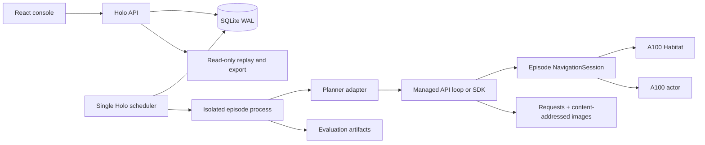

# Architecture

## Ownership

| Layer | Responsibility | Must not own |
|---|---|---|
| `frontend/src/pages` | Forms, status and evidence presentation | Navigation or scheduling decisions |
| `nav_harness/platform` | Auth, immutable experiments, queue, leases, service lifecycle, exports | Model-specific prompting logic |
| `nav_harness/core` | Validated contracts, artifacts, context budget, recovery evidence | GPU model loading |
| `nav_harness/providers` | Wire protocol and managed model/tool loop | Environment state or navigation tools |
| `navgpt/planner/tools/session.py` | Episode-local tool state and shared navigation capability | Global mutable episode state |
| `navgpt/planner/tools/subtasks.py` | Plan/review lifecycle and causal actor frame selection | Hidden goal or success labels |
| `navgpt/environment` | Simulator execution, observations and evaluator metrics | Planner/provider selection |
| `navgpt/vla` | Actor inference and history replacement | Experiment orchestration |

## Extension boundaries

`navgpt.planner.contracts` is provider-neutral. The runtime factory is the single
selection point for CLI and platform. API-compatible local models share
`CompatibleClient` and `ManagedRuntime`; model IDs never branch the navigation logic.
A different API protocol should add a client adapter and corresponding validation.
Existing Codex/Claude runtimes retain their SDK-driven tool transport and local login.
They are marked `sdk_observable_events_only`; SDK messages cannot be reconstructed
as exact model input. Managed API sessions record `exact_wire_requests`.

The MCP file is a transport entry point that creates one `NavigationSession`.
Navigation rules exist on the session instance. Two instances do not share mutable
plan, observation, map, budget or VLA state. Per-episode subprocess isolation additionally
keeps SDK state and crash handling separate.

## Context and causality

The managed context consists of the original instruction/system briefing and complete
assistant/tool-feedback blocks. Tool images follow their text results in a user image
message, with explicit originating call IDs. This mapping is in the recorded wire input.
Before each request the serving processor counts the actual messages and tool schemas,
including image tokens. Output and safety reserves are subtracted from the context cap.
The image cap is checked before tokenization.

`full` refuses overflow. `bounded` removes oldest whole feedback blocks, retains the
latest block and inserts the already-written task state/work summary. Without persisted
task state, pruning fails explicitly. It never synthesizes a summary from future events.
The full audit journal survives pruning. The context-selection record and model-request
record identify precisely what the model was given.

The existing actor context manager replaces context at task boundaries and preserves
causal current-task frames plus boundary context. `policy_context` events carry frame
IDs and the exact local instruction. All images needed for replay are stored locally.

Simulator metrics, goals and reference paths are evaluation artifacts. They are never
added to Planner or actor requests. The UI labels evaluator trajectory plots separately.
Map observations exposed by NavGPT-3 retain their original simulated geometry support;
this is a harness capability, not a learned model capability.

## Durable execution

SQLite uses WAL, foreign keys and `BEGIN IMMEDIATE` for claims and lifecycle fences.
An attempt owns its environment, actor and one Planner slot. One active attempt per job
preserves route order; independent jobs may run concurrently when resources permit.
Completed episodes are not automatically repeated. Failure recovery receives a new
attempt ordinal and directory. Configuration, launch-template snapshots and execution-source fingerprints are frozen.
The execution fingerprint covers navigation, providers, context and the episode executor;
control-plane/UI changes do not invalidate navigation configurations.

The worker lock prevents multiple schedulers. Each episode writes a process receipt
before execution. After a restart the worker verifies PID, Linux start ticks and the
exact input path, attaches to a surviving process or consumes its committed result.
An unexplained death retains leases. Even a result file cannot release a resource if
its trace contains an unacknowledged/errored movement request.

Managed service operations fence scheduler claims in the same database transaction.
An owned service is claimable only after readiness. Startup reservations include other
starting services; insufficient memory never evicts existing processes. Remote units
carry a generated `NAV_HARNESS_OWNER` token and use systemd process-group cleanup.
Only trusted configuration files contain executable argv; the browser cannot submit
shell commands. Register each physical stateful endpoint once; aliases are unsupported.

## Scope of v0.1

Single administrator, Linux control host, one scheduler, SQLite and systemd user services
are deliberate choices. There is no multi-tenant RBAC, cluster autoscaler, arbitrary
plugin execution, automatic trace training admission, or model-quality guarantee.
External endpoints can participate in experiments, but the platform cannot safely
reconcile their uncertain effects through process ownership it does not hold.
