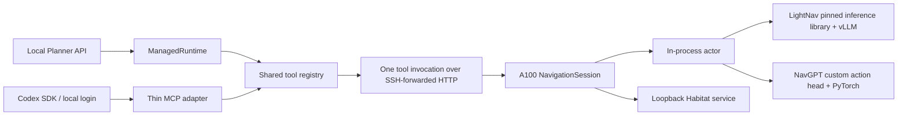

# Architecture

## Ownership

| Layer | Responsibility | Must not own |
|---|---|---|
| `frontend/src/pages` | Forms, status and evidence presentation | Navigation or scheduling decisions |
| `nav_harness/platform` | Auth, immutable experiments, queue, leases, service lifecycle, exports | Model-specific prompting logic |
| `nav_harness/core` | Validated contracts, artifacts, context budget, recovery evidence | GPU model loading |
| `nav_harness/providers` | Wire protocol and managed model/tool loop | Environment state or navigation tools |
| `navgpt/planner/tools/session.py` | Episode-local tool state and shared navigation capability | Global mutable episode state |
| `navgpt/planner/tools/subtasks.py` | Plan/review lifecycle and causal actor frame selection | Hidden goal or success labels |
| `navgpt/environment` | Simulator execution, observations and evaluator metrics | Planner/provider selection |
| `navgpt/vla` | Actor inference and history replacement | Experiment orchestration |

## Extension boundaries

`navgpt.planner.contracts` is provider-neutral. The runtime factory is the single
selection point for CLI and platform. API-compatible local models share
`CompatibleClient` and `ManagedRuntime`; model IDs never branch the navigation logic.
A different API protocol should add a client adapter and corresponding validation.
Existing Codex/Claude runtimes retain their SDK-driven tool transport and local login.
They are marked `sdk_observable_events_only`; SDK messages cannot be reconstructed
as exact model input. Managed API sessions record `exact_wire_requests`.

The MCP file is an optional transport entry point over the same tool registry.
Navigation rules exist on the session instance. Two instances do not share mutable
plan, observation, map, budget or VLA state. Per-episode subprocess isolation additionally
keeps SDK state and crash handling separate.

## Context and causality

The managed context consists of the original instruction/system briefing and complete
assistant/tool-feedback blocks. Tool images follow their text results in a user image
message, with explicit originating call IDs. This mapping is in the recorded wire input.
Before each request the serving processor counts the actual messages and tool schemas,
including image tokens. Output and safety reserves are subtracted from the context cap.
The image cap is checked before tokenization.

`full` refuses overflow. `bounded` removes oldest whole feedback blocks, retains the
latest block and inserts the already-written task state/work summary. Without persisted
task state, pruning fails explicitly. It never synthesizes a summary from future events.
The full audit journal survives pruning. The context-selection record and model-request
record identify precisely what the model was given.

The existing actor context manager replaces context at task boundaries and preserves
causal current-task frames plus boundary context. `policy_context` events carry frame
IDs and the exact local instruction. All images needed for replay are stored locally.

Simulator metrics, goals and reference paths are evaluation artifacts. They are never
added to Planner or actor requests. The UI labels evaluator trajectory plots separately.
Map observations exposed by NavGPT-3 retain their original simulated geometry support;
this is a harness capability, not a learned model capability.

## Durable execution

SQLite uses WAL, foreign keys and `BEGIN IMMEDIATE` for claims and lifecycle fences.
An attempt owns its environment, actor and one Planner slot. One active attempt per job
preserves route order; independent jobs may run concurrently when resources permit.
Completed episodes are not automatically repeated. Failure recovery receives a new
attempt ordinal and directory. Configuration, launch-template snapshots and execution-source fingerprints are frozen.
The execution fingerprint covers navigation, providers, context and the episode executor;
control-plane/UI changes do not invalidate navigation configurations.

The worker lock prevents multiple schedulers. Each episode writes a process receipt
before execution. After a restart the worker verifies PID, Linux start ticks and the
exact input path, attaches to a surviving process or consumes its committed result.
An unexplained death retains leases. Even a result file cannot release a resource if
its trace contains an unacknowledged/errored movement request.

Managed service operations fence scheduler claims in the same database transaction.
An owned service is claimable only after readiness. Startup reservations include other
starting services; insufficient memory never evicts existing processes. Remote units
carry a generated `NAV_HARNESS_OWNER` token and use systemd process-group cleanup.
Only trusted configuration files contain executable argv; the browser cannot submit
shell commands. Register each physical stateful endpoint once; aliases are unsupported.

## Scope of v0.1

Single administrator, Linux control host, one scheduler, SQLite and systemd user services
are deliberate choices. There is no multi-tenant RBAC, cluster autoscaler, arbitrary
plugin execution, automatic trace training admission, or model-quality guarantee.
External endpoints can participate in experiments, but the platform cannot safely
reconcile their uncertain effects through process ownership it does not hold.

## Lightweight execution path

`ToolRegistry` owns schemas, strict argument validation and text/image results without
importing MCP. `ManagedRuntime` calls it directly; Codex/Claude use the thin MCP adapter.
`open_tools` selects direct Python or the leased actor worker's RPC transport. There is
one `NavigationSession`, not separate implementations for each transport or model.

The actor worker owns weights for its process lifetime, and one episode at a time.
A session ID fences other clients and legacy actor mutations. Duplicate request IDs
are rejected. Dispatch/result receipts are flushed to disk before responding. Unknown
movement outcomes retain ownership; no transport retries movement. Artifacts synchronize
at tool boundaries with an acknowledgment cursor; local paths are rewritten for replay.
Codex credentials remain on Holo. Worker ports bind to A100 loopback and use direct-LAN
SSH forwarding. Habitat remains a separate interpreter because its dependencies differ.

An actor's executable source fingerprint and configured environment endpoint must match
preflight. Deploy immutable release directories; changing code requires new experiments
and a worker restart after current episodes finish. A failed session requires explicit
owned-service recovery, not an implicit model reset.

## Model-owned workflow

`harness.mode: agentic` keeps plan/state/history provenance but removes strict review
permissions. The model selects the task, remaining instruction, segment budgets, and
actor history window (1–16 groups with 0–4 boundary groups). The current frame is always
retained. It can repair or revise without first calling a review tool, retrieve node
images, and stop independently of plan checkboxes. Initial observation/decomposition
and evidence-based handoff review are prompting guidance. `subtask` preserves the
previous strict workflow for comparisons; `global` preserves full-route delegation.

### Plan/memory tool contract v1

Agentic mode exposes ten tools. `update_plan` and `update_memory` replace the previous
plan/review/annotation surface; `annotate_node` and `review_subtask` remain only in legacy
profiles. Existing frozen experiments require a new configuration/source fingerprint.
The state records `tool_contract: plan_memory_v1`.

`update_plan(subtasks, reason)` replaces the complete ordered plan. Each item requires
`id` (positive integer), `instruction`, `completion_criterion`, and `status`:
`pending`, `in_progress`, or `completed`. IDs must be unique, with at most one item
in progress. Fields outside this schema are rejected. Retained tasks keep their IDs;
incorrect completions can be reopened through a new plan. Validation precedes mutation.
The old `active`/`accepted` statuses are not silently accepted in this contract.
Executing a selected unfinished task marks it in progress; only a plan update can
mark it completed. The plan never starts movement by itself.

`update_memory(node_id, caption)` takes exactly those two required fields. `node_id`
is the existing integer map-node ID. `caption` combines spatial description, execution
review, failed attempts and uncertainty. It replaces only that node's previous caption,
without changing task status, node geometry, return anchors or recorded photographs.
Captions contain 1–800 characters, with a 4000-character total budget. An overflow is a
recoverable error asking the model to shorten existing captions, never silent truncation.

Only a successful **explicit** `observe_map` grants memory-write access. The session
records its call number, image SHA-256, shown node IDs, motion epoch and camera frame.
The target must be among that map's node IDs. Failed reads revoke access. Any dispatched
movement/rotation or new VLA execution invalidates the receipt, even if the VLA immediately
stops. Automatically returned rollout/retrace maps do not grant access. Several nodes
may be annotated from one valid read. Rejections change no captions or task state and
return tool-error feedback; unknown movement outcomes still retain ownership.

The managed loop rejects an entire response containing both `observe_map` and
`update_memory` before executing it: the model must receive the image in a preceding
turn. The shared session gate applies equally to direct, RPC and MCP calls. MCP alone
does not expose the SDK's model-request boundaries; it verifies a completed map read
before a write, while the preceding-model-turn check is enforced by the managed loop.
Do not describe SDK-only traces as proof of exact model-input visibility.

Memory updates keep previous captions in the event journal, write current captions to
the same node-label store, and include the latest memory catalog in task state. That
catalog survives bounded context pruning. The most recently updated caption, including
its node ID and uncertainty, is passed as background to the next VLA call. There is no
hidden summarizer or automatic claim of task completion. Tool schemas, state transition
rules, map gating and transport behavior are covered by contract tests.

Malformed tool arguments reject the whole unexecuted batch and return repair feedback.
The next model call can correct them. A repeated call ID, uncertain movement, truncated
response or missing explicit STOP remains an execution error. This distinction prevents
a formatting mistake from being confused with failed navigation or unsafe retry.

Bounded Planner context retains a pruning cursor and uses exponential advancement on
overflow, followed by an authoritative tokenizer check. Discarded turns are not repeatedly
resent to the counter. The complete trace remains available for supervision and replay.

Actor supervision records preserve native horizons: each `policy_context`,
`policy_prediction`, `policy_execution_dispatch`, and `policy_execution_result` shares
an episode-local `prediction_id`. Predictions contain the original waypoints and
controller advice; execution results contain observed pose, step count and navigation
status. An unacknowledged dispatch has no fabricated result. LightNav's 10 points are
not silently converted to the native VLA's 8 points or relabelled with a time interval.
Dataset resampling and training admission are separate, reviewed operations.
