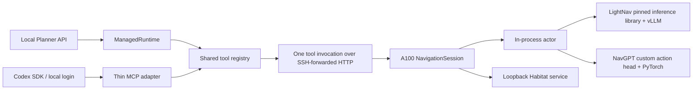

# Architecture

## Ownership

| Layer | Responsibility | Must not own |
|---|---|---|
| `frontend/src/pages` | Forms, status and evidence presentation | Navigation or scheduling decisions |
| `nav_harness/platform` | Auth, immutable experiments, queue, leases, service lifecycle, exports | Model-specific prompting logic |
| `nav_harness/core` | Validated contracts, artifacts, context budget, recovery evidence | GPU model loading |
| `nav_harness/providers` | Wire protocol and managed model/tool loop | Environment state or navigation tools |
| `navgpt/planner/tools/session.py` | Episode-local tool state and shared navigation capability | Global mutable episode state |
| `navgpt/planner/tools/subtasks.py` | Plan/review lifecycle and causal actor frame selection | Hidden goal or success labels |
| `navgpt/environment` | Simulator execution, observations and evaluator metrics | Planner/provider selection |
| `navgpt/vla` | Actor inference and history replacement | Experiment orchestration |

## Extension boundaries

`navgpt.planner.contracts` is provider-neutral. The runtime factory is the single
selection point for CLI and platform. API-compatible local models share
`CompatibleClient` and `ManagedRuntime`; model IDs never branch the navigation logic.
A different API protocol should add a client adapter and corresponding validation.
Existing Codex/Claude runtimes retain their SDK-driven tool transport and local login.
They are marked `sdk_observable_events_only`; SDK messages cannot be reconstructed
as exact model input. Managed API sessions record `exact_wire_requests`.

The MCP file is an optional transport entry point over the same tool registry.
Navigation rules exist on the session instance. Two instances do not share mutable
plan, observation, map, budget or VLA state. Per-episode subprocess isolation additionally
keeps SDK state and crash handling separate.

## Context and causality

The managed context consists of the original instruction/system briefing and complete
assistant/tool-feedback blocks. Tool images follow their text results in a user image
message, with explicit originating call IDs. This mapping is in the recorded wire input.
Before each request the serving processor counts the actual messages and tool schemas,
including image tokens. Output and safety reserves are subtracted from the context cap.
The image cap is checked before tokenization.

`full` refuses overflow. `bounded` removes oldest whole feedback blocks, retains the
latest block and inserts the already-written task state/work summary. Without persisted
task state, pruning fails explicitly. It never synthesizes a summary from future events.
The full audit journal survives pruning. The context-selection record and model-request
record identify precisely what the model was given.

Actor input contracts are selected by `navgpt/vla/profiles.py`, independently of
Planner context pruning. NavGPT VLA uses bounded replacement at task boundaries.
LightNav retains its native continuous episode buffer and SlowFast sampler; task
changes only revise instruction text. `policy_context` events preserve source frame
IDs. The client appends unseen frames, and re-inference at a stationary endpoint
reuses the last observation instead of inventing another timestep.

Simulator metrics, goals and reference paths are evaluation artifacts. They are never
added to Planner or actor requests. The UI labels evaluator trajectory plots separately.
Map observations exposed by NavGPT-3 retain their original simulated geometry support;
this is a harness capability, not a learned model capability.

## Durable execution

SQLite uses WAL, foreign keys and `BEGIN IMMEDIATE` for claims and lifecycle fences.
An attempt owns its environment, actor and one Planner slot. One active attempt per job
preserves route order; independent jobs may run concurrently when resources permit.
Completed episodes are not automatically repeated. Failure recovery receives a new
attempt ordinal and directory. Configuration, launch-template snapshots and execution-source fingerprints are frozen.
The execution fingerprint covers navigation, providers, context and the episode executor;
control-plane/UI changes do not invalidate navigation configurations.

The worker lock prevents multiple schedulers. Each episode writes a process receipt
before execution. After a restart the worker verifies PID, Linux start ticks and the
exact input path, attaches to a surviving process or consumes its committed result.
An unexplained death retains leases. Even a result file cannot release a resource if
its trace contains an unacknowledged/errored movement request.

Managed service operations fence scheduler claims in the same database transaction.
An owned service is claimable only after readiness. Startup reservations include other
starting services; insufficient memory never evicts existing processes. Remote units
carry a generated `NAV_HARNESS_OWNER` token and use systemd process-group cleanup.
Only trusted configuration files contain executable argv; the browser cannot submit
shell commands. Register each physical stateful endpoint once; aliases are unsupported.

## Scope of v0.1

Single administrator, Linux control host, one scheduler, SQLite and systemd user services
are deliberate choices. There is no multi-tenant RBAC, cluster autoscaler, arbitrary
plugin execution, automatic trace training admission, or model-quality guarantee.
External endpoints can participate in experiments, but the platform cannot safely
reconcile their uncertain effects through process ownership it does not hold.

## Lightweight execution path

`ToolRegistry` owns schemas, strict argument validation and text/image results without
importing MCP. `ManagedRuntime` calls it directly; Codex/Claude use the thin MCP adapter.
`open_tools` selects direct Python or the leased actor worker's RPC transport. There is
one `NavigationSession`, not separate implementations for each transport or model.

The actor worker owns weights for its process lifetime, and one episode at a time.
A session ID fences other clients and legacy actor mutations. Duplicate request IDs
are rejected. Dispatch/result receipts are flushed to disk before responding. Unknown
movement outcomes retain ownership; no transport retries movement. Artifacts synchronize
at tool boundaries with an acknowledgment cursor; local paths are rewritten for replay.
Codex credentials remain on Holo. Worker ports bind to A100 loopback and use direct-LAN
SSH forwarding. Habitat remains a separate interpreter because its dependencies differ.

An actor's executable source fingerprint and configured environment endpoint must match
preflight. Deploy immutable release directories; changing code requires new experiments
and a worker restart after current episodes finish. A failed session requires explicit
owned-service recovery, not an implicit model reset.

## Model-owned workflow

`harness.mode: agentic` keeps plan/state/history provenance but removes strict review
permissions. The model selects the task and remaining instruction; execution and
history budgets belong to runtime configuration. NavGPT VLA retains a bounded
window (1–16 groups with 0–4 boundary groups). LightNav uses its native episode
history. The current frame is always retained. It can repair or revise without first calling a review tool, retrieve node
images, and stop independently of plan checkboxes. Initial observation/decomposition
and evidence-based handoff review are prompting guidance. `subtask` preserves the
previous strict workflow for comparisons; `global` preserves full-route delegation.

### Topology memory contract v2

Agentic mode exposes eleven tools, including `update_plan`, `update_memory` and
`read_memory`. Legacy profiles retain their old interfaces. New experiments must freeze
new configuration/source fingerprints; old traces are not reinterpreted as v2. The
pre-change implementation and annotation audit are preserved at commit `b281792`.

`update_plan(subtasks, reason)` replaces the ordered plan. Each task has a unique positive
`id`, `instruction`, `completion_criterion`, and `status` (`pending`, `in_progress`,
`completed`), with at most one in progress. Only plan updates mark completion.

One `TopologyMemory` owns the graph in `live/subtasks/topology.json`, independent of the
legacy dense geometric graph. Nodes contain stable IDs, actual 3D positions and frame
references; a new boundary reuses the closest node within 0.25 m in 3D, or creates a node.
This is conservative geometric matching, not visual room recognition. Observe calls do
not create new nodes after initialization. Every public movement (`execute_subtask`,
`navigate_relative`, `navigate_to_node`) records one directed execution edge, including
zero-displacement/self-loop and unsuccessful attempts. Parallel and reverse traversals
remain distinct. The dense actual trajectory is retained for execution and retracing,
not exposed as additional memory nodes. Return uses a 3D match on the recorded path;
it never infers a shortcut through unknown ground.

System-owned edge fields are internal ID/order, actual start/end nodes and poses, tool,
arguments, task snapshot, trajectory, ordered frame references, execution status and stop
reason. The **only model-authored memory field is caption**. Failure/exploration/return
interpretations belong in that caption, not a system-invented semantic classification.
A missing motion response leaves an uncertain, unclosed edge and retains ownership;
it cannot invent an endpoint or retry. Validation before movement cancels the tentative
edge. Backend STOP and budget expiry never establish task completion.

`update_memory(start_node_id, end_node_id, caption)` has exactly three required fields.
IDs are the numbers on the map, not task IDs or internal edge IDs. It writes only the
pending execution; repeat calls revise that execution, never earlier trips with the
same endpoints. Beginning a new execution closes the prior write window. Captions are
1–800 characters; storage has no old 4000-character global cap. Full previous captions
and map-read evidence remain in the event journal. No parallel node-caption store exists.

Only an explicit successful `observe_map` grants write access. The receipt records image
SHA-256, shown IDs, frame, motion epoch and pending execution. Both endpoints must be
shown and match the pending edge. Every motion or VLA call invalidates it; automatic
handoff maps, `read_memory` and failed map reads do not grant access. The managed loop
rejects batches containing both map read and memory write before executing any tool.
MCP enforces completed tool-read-before-write but cannot independently certify SDK
model-request boundaries.

The same map renderer draws the memory node layer for agentic mode (with a capability
check preventing old dense IDs from being mistaken for memory IDs). The latest actual
execution path is cyan; numbered nodes and the current heading remain visible. VLA
keyframes and endpoint views are still returned automatically. `observe_map` also returns
current execution, selected captions and an omitted-history index through task state.

Context selection is deterministic: current execution always retained; latest three
recorded executions; up to five additional current-node-adjacent records, prioritizing
same-task association then recency, with directed-pair deduplication. No hidden semantic
classifier claims to recognize all failures. Whole older records are removed to fit a
6000 UTF-8-byte memory budget (a conservative byte-tokenizer bound); up to twelve hidden
pair counts advertise retrieval. Complete history stays persisted. The serving tokenizer
still checks the entire request. Uncaptioned executions are explicit, not omitted as if
they never happened. The managed loop replaces repeated task/map summary snapshots with
one current persisted state, while preserving original tool responses in the trace.
SDK-managed conversation compaction is external; do not claim identical prompt replacement
there. The most recent caption is bounded background for the VLA, not a new instruction.

`read_memory(node_id, other_node_id=None, include_images=False, offset=0)` selects incident
history, or only the specified directed pair. It returns five executions newest-first,
explicit pagination and system facts plus model captions. Optional images are capped at
four sampled chronological frames across the page; references/counts disclose omissions.
`observe_node` remains a lightweight single-place-image lookup using the same memory IDs.
The memory read does not move, write, or grant map-read permission.

Malformed tool arguments reject the whole unexecuted batch and return repair feedback.
The next model call can correct them. A repeated call ID, uncertain movement, truncated
response or missing explicit STOP remains an execution error. This distinction prevents
a formatting mistake from being confused with failed navigation or unsafe retry.

Bounded Planner context retains a pruning cursor and uses exponential advancement on
overflow, followed by an authoritative tokenizer check. Discarded turns are not repeatedly
resent to the counter. The complete trace remains available for supervision and replay.

Actor supervision records preserve native horizons: each `policy_context`,
`policy_prediction`, `policy_execution_dispatch`, and `policy_execution_result` shares
an episode-local `prediction_id`. Predictions contain the original waypoints and
controller advice; execution results contain observed pose, step count and navigation
status. An unacknowledged dispatch has no fabricated result. LightNav's 10 points are
not silently converted to the native VLA's 8 points or relabelled with a time interval.
Dataset resampling and training admission are separate, reviewed operations.
